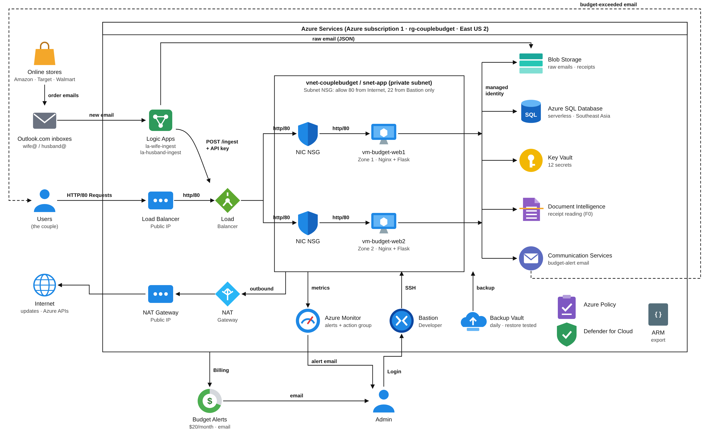

# InboxLedger:

A shared purchase tracker for couples, built on Microsoft Azure for MSIT Cloud Computing (Fall 2026).

InboxLedger reads order-confirmation emails sent to two Outlook.com inboxes, one for the wife and one for the husband. It works out the store, the amount and the category, and shows the spending on a dashboard with **Wife**, **Husband** and **Household** views. When a PDF receipt is attached, Azure Document Intelligence reads it. When someone goes over their monthly budget, the app sends an alert email through Azure Communication Services.

## How it works:

1. A store emails an order confirmation to the wife's or the husband's Outlook.com inbox.
2. A Logic App (`la-wife-ingest` / `la-husband-ingest`) starts on each new email whose subject contains "order".
3. The Logic App saves the raw email as JSON in Blob Storage, then POSTs it to the app with an API key.
4. A Standard Load Balancer sends the request to one of two Ubuntu VMs, which sit in different availability zones inside a private subnet.
5. The Flask app (Gunicorn behind Nginx) reads every setting from Key Vault using the VM's managed identity. It stores receipts in Blob and reads PDFs with Document Intelligence, then saves the purchase in Azure SQL Database.
6. If a person goes over their monthly budget, Communication Services sends one alert email for that month.

## Azure services used:

| Area | Service |
|---|---|
| Compute | 2 × Virtual Machines (Ubuntu 24.04), Standard Load Balancer |
| Networking | Virtual Network, Network Security Groups (subnet + NIC), NAT Gateway, Azure Bastion (Developer) |
| Data | Azure SQL Database (serverless, free offer), Blob Storage |
| Security | Key Vault + managed identities, Azure Policy, Defender for Cloud |
| Integration / AI | Logic Apps, Document Intelligence (prebuilt-receipt), Communication Services (email) |
| Operations | Azure Monitor alerts + action group, VM insights, Azure Backup (restore tested), Cost Management budget |

## Repository contents:

| Path | What it is |
|---|---|
| `infra/setup.sh` | One script that installs Nginx, Python, the ODBC driver and the Flask app on a VM. It was run on both VMs with Run Command. |
| `infra/template.json` | ARM template exported from the resource group (secrets removed) |
| `samples/sample-emails.txt` | The six test order emails used for testing |
| `samples/receipts/` | Sample PDF receipts used to test Document Intelligence |
| `docs/` | Architecture diagrams |

## Security notes:

- **No secrets are stored in this repository.** The VMs know only the Key Vault name; every password and key is read from Key Vault at runtime.
- The ingest API key was removed from `template.json`, and the subscription ID was replaced with zeros.
- The VMs have no public IPs. Admin access goes through Azure Bastion only.

## Deploying it again:

1. Create the resources shown in the diagram, or start from `infra/template.json` after adding your own parameter values.
2. Add the required secrets to the Key Vault: `sql-server`, `sql-database`, `sql-user`, `sql-password`, `storage-account`, `ingest-api-key`, `dashboard-password`, `docintel-endpoint`, `docintel-key`, `acs-connection-string`, `acs-sender`, `alert-emails`.
3. Give each VM's managed identity the *Key Vault Secrets User* and *Storage Blob Data Contributor* roles.
4. Set `KEY_VAULT_NAME` at the top of `infra/setup.sh`, then run it on each VM:
   `az vm run-command invoke -g <rg> -n <vm> --command-id RunShellScript --scripts @infra/setup.sh`

The Azure resources were deleted after the project was finished.

## Acknowledgements:

I used Claude (Anthropic) as a learning aid for step-by-step guidance and troubleshooting; all Azure resources were deployed, configured and tested by me.
